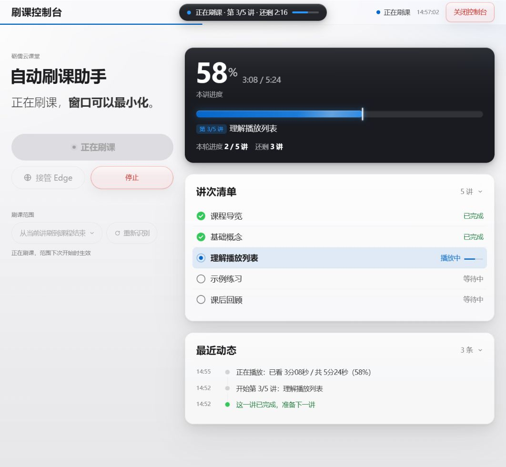

<h1 align="center">砺儒云课堂助手</h1>

<strong>将视频交给助手，把时间留给自己。</strong>

  <strong><a href="https://github.com/MuuZiy/liru-cloud-assistant/releases/latest">下载 Windows 稳定版</a></strong>
  · <a href="https://github.com/MuuZiy/liru-cloud-assistant/releases">查看测试版</a>
  · <strong><a href="使用说明.txt">新手教程</a></strong>
  · <a href="免责声明.txt">免责声明</a>

Windows 10/11（64 位） · Microsoft Edge

> [!IMPORTANT]
> **日常使用请选择「下载 Windows 稳定版」。** 在发布页的 Assets（附件）中下载文件名以 `-windows.zip` 结尾的安装包，不要选 Source code。
>
> 标有 **Pre-release** 的是测试版。v1.0.1 已通过离线验证，尚未测试真实课程。Windows 版自带 Python，解压后即可按教程启动。

*界面演示使用模拟课程数据。*

## 功能介绍

- **自动播放**　选好范围后，助手会按课程顺序自动播放视频。
- **自动考勤确认**　遇到支持的考勤弹窗会自动确认，需要你亲自处理时会提醒你。
- **后台运行**　开始后可以把 Edge 窗口最小化，让助手继续运行。
- **按章选择**　可以从当前讲继续，也可以只播放你选的章节。
- **查看进度**　打开控制台，就能看到正在播哪一讲、播了多久、还剩几讲。

## 如何使用

首次使用请打开 [新手教程](使用说明.txt)，按步骤启动控制台、授权 Edge 并识别课程。

## 免责声明

使用前请阅读 [免责声明](免责声明.txt)，并确认学校、课程和平台规则允许使用自动化工具。

## 问题反馈

遇到问题可到 [GitHub Issues](https://github.com/MuuZiy/liru-cloud-assistant/issues) 反馈。请附上工具版本、操作步骤和报错提示，截图和日志中的个人信息请先遮盖。

[MIT 许可](LICENSE) · [第三方许可](第三方许可.md)
